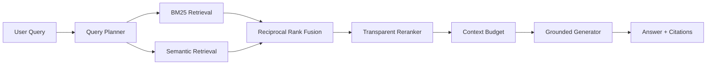

# 🧠 Agentic RAG Engine V2

**A MAK'MA Studio Product · MAK'MA Labs**

[Live Product Demo](https://maharshimak.github.io/makma-ai-os/projects/agentic-rag-engine/) · [MAK'MA Labs](https://maharshimak.github.io/makma-ai-os/projects/)

An inspectable Retrieval-Augmented Generation engine with **document chunking, BM25-style lexical search, semantic retrieval, reciprocal-rank fusion, multi-query planning, transparent reranking, context budgeting, citations, evaluation, FastAPI, Docker, and OpenAI-compatible model adapters**.


## Product contract — engineering upgrade

**Problem and audience:** A retrieval laboratory for engineers comparing evidence rankings against their own small corpus and judgments.

**Live tool:** https://maharshimak.github.io/makma-ai-os/projects/agentic-rag-engine/

**Implemented browser workflow:** Editable text/JSON corpus, strict Top K/Candidate K/BM25/RRF configuration, planned queries, per-stage scores, cited context, comparable baseline rankings and JSON export. No judgments displays N/A rather than a fake zero-quality score.

**Backend and parity contract:** Python and browser use SHA-256 token bytes, 256 buckets, digest sign bit, L2 normalization, BM25, RRF and transparent overlap reranking. Fixed fixtures execute the Python packages and compare JS outputs. Internal no-judgment convention: recall=1, precision=0, MRR=0, hit=0. Python additionally chunks documents, budgets context and supports external providers; the browser ranks supplied documents directly.

**Architecture:** `makma-ai-os/demo` is the shared web product source and Pages deployment. This repository owns its Python domain package. The central `tests/e2e` suite exercises all nine products; `tests/fixtures/python-parity.json` plus `scripts/generate_parity.py` guard shared mathematical contracts. Backend revisions used for regeneration are pinned in the central `backend-lock.json`.

**Safety and limitations:** Hash vectors are lexical hashing, not learned semantic embeddings. Browser limits: 200 documents, 100000 corpus characters, 2000 query characters. Baseline comparisons require identical corpus/query/judgments. Inputs are validated, rendered user values are escaped, and deterministic results are not presented as model inference.

**Verification:** Run `python -m ruff check .` and `python -m pytest -q`. `tests/test_engineering_upgrade.py` protects the new rejection/correctness paths. Central web checks: `npm ci`, `npm test`, `npm run build`, `npx playwright install --with-deps chromium`, `npm run test:e2e`. CI gates publishing on browser interactions and validates all public URLs after deployment.

**Highest-value next work:** Labeled domain benchmarks, persistent vector storage and calibrated trained reranking.

**Provenance:** Independent MAK’MA Studio engineering implementation; examples are synthetic and no employer code or data is included. Existing MIT license applies.


## Architecture



## What is implemented

- typed `Document`, `Chunk`, scored-result and trace models
- deterministic overlapping document chunking
- real BM25-style lexical index
- deterministic offline embedding provider for reproducible CI
- optional SQLite source-document persistence with reload-on-start and persistent deletion
- optional persistent content-addressed SQLite embedding cache to avoid re-embedding unchanged chunks
- OpenAI-compatible `/v1/embeddings` adapter for real local/cloud embedding servers
- cosine semantic retrieval
- reciprocal-rank fusion across lexical, semantic and planned-query rankings
- deterministic multi-query decomposition for compound questions
- interpretable reranker with a replaceable cross-encoder boundary
- token-budgeted citation context construction
- offline grounded extractive generation
- OpenAI-compatible `/v1/chat/completions` generator for real LLMs
- Recall@K, Precision@K, MRR, Hit Rate and graded nDCG@K evaluation
- deterministic tie-breaking (score, then chunk ID) so rankings do not depend on insertion or reload order
- chunk character offsets, SHA-256 span provenance, index fingerprints and answer-citation verification
- `makma.v1` contract operations (`ingest`, `retrieve`, `answer`, `delete_document`)
- FastAPI indexing, retrieval and answer endpoints
- latency and retrieval tracing
- Docker support
- compatibility layer for the original V1 API
- automated tests and GitHub CI

## Quick start

```bash
pip install -e ".[dev]"
pytest -q
uvicorn rag_engine.api:app --reload
```

Open `http://localhost:8000/docs`.

## API

- `GET /health`
- `POST /v1/documents/index`
- `POST /v1/retrieve`
- `POST /v1/answer`
- `GET /v1/capabilities` (`makma.v1`)
- `POST /v1/ops/{operation}` (`makma.v1` envelope)

All routes except `/health` use the same local-only / bearer-token check.

## Evidence provenance and determinism

- Each chunk records `start_char`/`end_char` (Python string indices, end-exclusive) into its source `Document.text`. `chunk.text` is the whitespace-normalized form of that span; `rag_engine.provenance.source_span()` returns the exact source slice, or `None` if the document changed.
- `RAGEngine.index_fingerprint()` is a SHA-256 over canonical JSON of every indexed chunk (ID, document ID, text hash, offsets, metadata) plus the embedding provider identity (`sha256_token_hash` + dimensions, or the configured model name). It is independent of insertion order and is reported as `trace.index_fingerprint` on every retrieval.
- Rankings sort by score, then chunk ID, at every stage, so the same corpus and query return the same order after a restart or a different ingestion order.
- `answer()` returns `citations` (chunks placed in the context, always a subset of the retrieved set), `answer_citations` (citation-shaped `[doc::cN]` IDs in the answer that were in the context) and `unsupported_citations` (citation-shaped IDs in the answer that were not). This checks that cited IDs exist; it does not check that the cited text supports the claim.
- Deleting a document rebuilds the index; tests assert deleted documents never appear in retrieval results, contexts or citations across repeated queries.

## `makma.v1` contract

`rag_engine.contracts.run_operation(operation, payload, *, run_id=None, correlation_id=None, engine=None)` returns the shared envelope validated by `contracts/makma.v1.schema.json`; `capabilities()` lists the operations and their input JSON Schemas.

| Operation | Input | `data` | Side effects |
| --- | --- | --- | --- |
| `ingest` | `documents: [{id, text, metadata?}]` (1–100) | `documents`, `document_ids`, `indexed_chunks`, `index_fingerprint` | yes |
| `retrieve` | `query`, `top_k` (1–50, default 5) | `results` (chunk ID, document ID, text, text SHA-256, offsets, per-stage scores), `trace` | no |
| `answer` | `query`, `top_k` | `answer`, `abstained`, `confidence`, `citations`, `answer_citations`, `unsupported_citations`, `citations_in_retrieved_set`, `context`, `retrieved_chunk_ids`, `trace` | no |
| `delete_document` | `document_id` | `document_id`, `deleted`, `documents_remaining`, `index_fingerprint` | yes |

Provenance entries are `document` (ingest; SHA-256 of the full text) or `chunk` (retrieve/answer; SHA-256 of the exact source span, with `span = [start_char, end_char]`). `execution_mode` is `deterministic_offline` with the default hash embeddings, extractive generator and heuristic planner/reranker; it becomes `local_model` or `remote_model` when a configured OpenAI-compatible endpoint (loopback host vs. other host) or a cross-encoder participates. Error codes: `UNKNOWN_OPERATION`, `INVALID_INPUT`, `INDEX_EMPTY`, `PROVIDER_UNAVAILABLE` (retryable), `INTERNAL_ERROR`. Over HTTP these map to 404, 422, 409, 503 and 500, with the envelope as the body; `X-Correlation-ID` sets `correlation_id`.

## Offline retrieval benchmark

`benchmarks/retrieval_v1.json` is a hand-written synthetic corpus (12 documents, one deleted after ingestion) with 14 queries and graded judgments (0/1/2). It includes near-duplicate documents, a prompt-injection document, an identifier near-miss (`ERR_TLS_041` vs `ERR_TLS_042`), vocabulary-mismatch paraphrases, a query whose only matching document is deleted, and an unanswerable query. Judgments were written by the author of the dataset, before running the engine, and have not been independently reviewed.

```bash
python -m rag_engine.benchmark benchmarks/retrieval_v1.json --k 5 --output report.json
```

The report is document-level and records `dataset_sha256` (SHA-256 of the dataset's canonical JSON, pinned in `tests/test_benchmark_dataset.py`), the index fingerprint and engine configuration. It also checks invariants: rankings and fingerprint identical when the corpus is ingested in reverse order, no deleted-document leaks, all context citations within the retrieved set. The command exits non-zero if an invariant fails.

Measured with the default offline engine (SHA-256 token-hash vectors, BM25, heuristic reranker), `k=5`, Python 3.12.10 on Windows 11, dataset SHA-256 `5688b37a…c4ee4f`:

| Answerable queries (12) | Recall@5 | Precision@5 | MRR | nDCG@5 | Citation coverage |
| --- | --- | --- | --- | --- | --- |
| mean | 0.833 | 0.217 | 0.833 | 0.833 | 0.833 |

The two misses are `q07` ("paid time off" vs. "vacation" — no shared vocabulary) and `q12` ("receipt upload" vs. "Receipts … uploaded" — the tokenizer does not stem). Precision@5 is bounded at 0.2 for single-relevant-document queries. For the two unanswerable queries the abstention rate was 0.0: retrieval confidence ranged 0.55–0.69 for every query, so the current confidence score does not separate answerable from unanswerable queries on this dataset. These numbers describe this small synthetic dataset only. The benchmark complements the hit-rate/MRR regression gate proposed in draft PR #10.

## Use a real OpenAI-compatible model server

The default configuration is fully offline so tests and demos are reproducible. To connect Ollama/vLLM/LM Studio or another OpenAI-compatible gateway, configure the following environment variables:

```bash
export RAG_EMBEDDING_BASE_URL=http://localhost:11434
export RAG_EMBEDDING_MODEL=nomic-embed-text
export RAG_CHAT_BASE_URL=http://localhost:11434
export RAG_CHAT_MODEL=qwen3
export RAG_API_KEY=
export RAG_API_TOKEN=replace-with-a-long-random-token
```

The engine automatically switches from the deterministic offline providers to the configured model endpoints.

## Why this project matters

This repository is intentionally built beyond the common `embed → vector search → prompt` demo. The retrieval path separates planning, lexical search, semantic search, fusion, reranking, context construction, generation and evaluation so each stage can be tested, benchmarked and replaced independently.

## Next engineering milestones

- persistent Qdrant/pgvector adapter
- learned cross-encoder reranker
- LLM-driven query decomposition and iterative retrieval
- ingestion workers for PDF/HTML/Markdown
- groundedness and citation-faithfulness evaluation
- OpenTelemetry-compatible tracing
- benchmark datasets and regression gates

Built as an engineering portfolio project focused on production GenAI systems.

## Scope and limitations

Offline embeddings use token hashing, not a trained semantic model. The reranker and query planner are deterministic heuristics. Retrieval indexes still live in memory and are rebuilt when documents change; source documents can optionally persist in SQLite and are reloaded on engine startup. When a real or local embedding provider is wrapped by `SQLiteCachedEmbeddingProvider`, unchanged text embeddings persist across rebuilds and process restarts. Input is already-extracted text; PDF/OCR/HTML ingestion is not implemented. Citations identify supplied context but do not establish answer faithfulness. The synthetic retrieval tests and `benchmarks/retrieval_v1.json` are regression fixtures, not a general retrieval benchmark. Remote adapters require an independently hosted compatible service and are not validated against live providers by offline CI.

## Installation and development

Requires Python 3.12 or newer. Run from this project directory.

```bash
python -m venv .venv
source .venv/bin/activate
python -m pip install -e ".[dev]"
python -m ruff check .
python -m pytest -q
python -m pip wheel --no-deps . -w dist
```

On Windows, activate with `.venv\Scripts\Activate.ps1`.

## Library usage

```python
from rag_engine.models import Document
from rag_engine.service import RAGEngine

engine = RAGEngine()
engine.index([Document("memory", "SQLite stores persistent conversation memory.")])
print(engine.answer("What stores conversation memory?"))
```

## Configuration

See [.env.example](.env.example). Export variables into the process environment; the application does not automatically load that file. Keep real credentials out of Git.

## Service and API schema

```bash
python -m uvicorn rag_engine.api:app --host 127.0.0.1 --port 8000
```

Interactive endpoint schemas are at `http://127.0.0.1:8000/docs`; machine-readable schemas are at `/openapi.json`. The API is local-only by default. Set `RAG_API_TOKEN` to enable bearer-authenticated remote access; all non-health endpoints then require `Authorization: Bearer <token>`.

## Container

```bash
docker build -t agentic-rag-engine .
docker run --rm -p 127.0.0.1:8000:8000 agentic-rag-engine
```

## Repository structure

| Path | Purpose |
| --- | --- |
| `src/rag_engine/` | Implementation |
| `tests/` | Offline unit and regression tests |
| `docs/DESIGN.md` | Architecture and trust boundaries |
| `.github/workflows/ci.yml` | Install, lint, tests, wheel and container build |
| `pyproject.toml` | Dependencies and package configuration |

## Next engineering work

Persistent index adapter; labeled retrieval benchmark; citation-faithfulness checks; trained reranker; background ingestion. These are planned work, not current capabilities.

## Contributing and security

See [CONTRIBUTING.md](CONTRIBUTING.md) and [SECURITY.md](SECURITY.md). CI runs on every push and pull request through `.github/workflows/ci.yml`.

## License and provenance

[MIT](LICENSE), copyright 2026 Maharshi Patel. This public portfolio implementation is independent of employer systems and contains no confidential employer code or data. Examples and test fixtures are synthetic.
